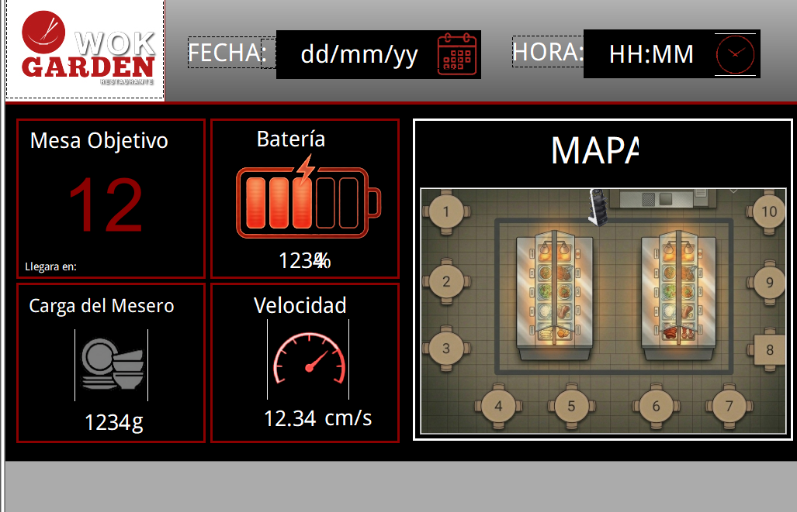
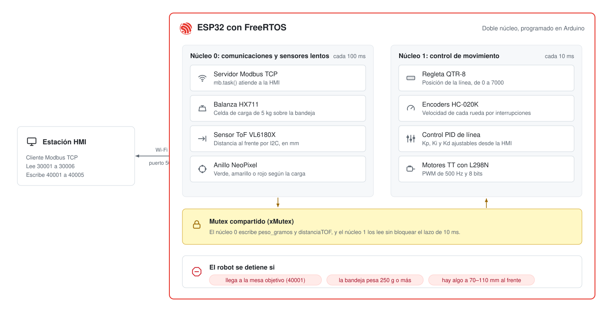
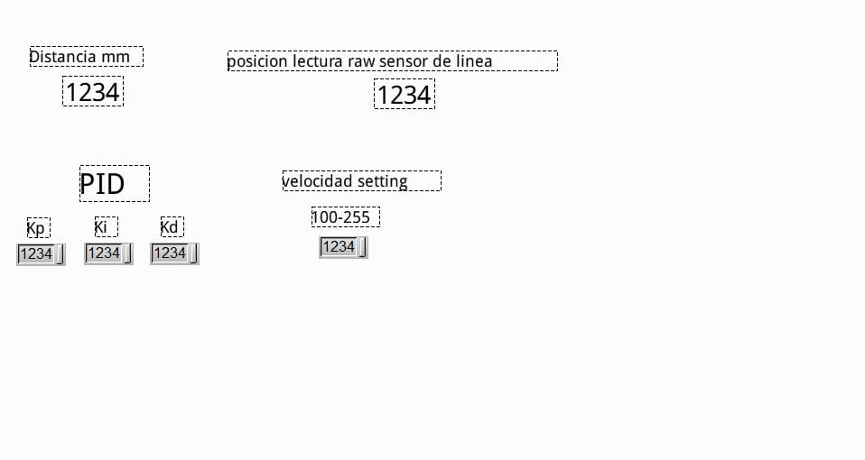
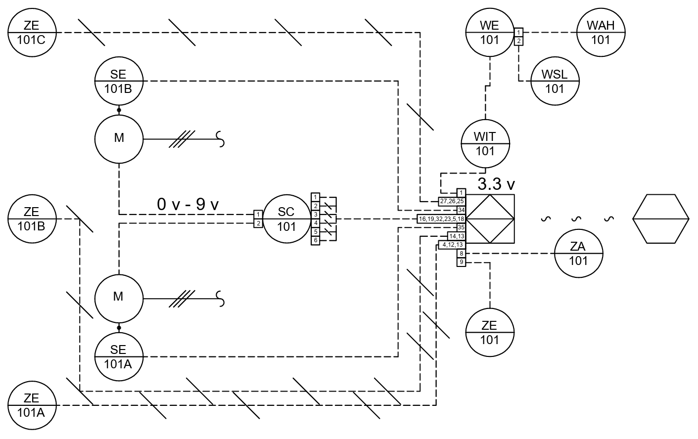
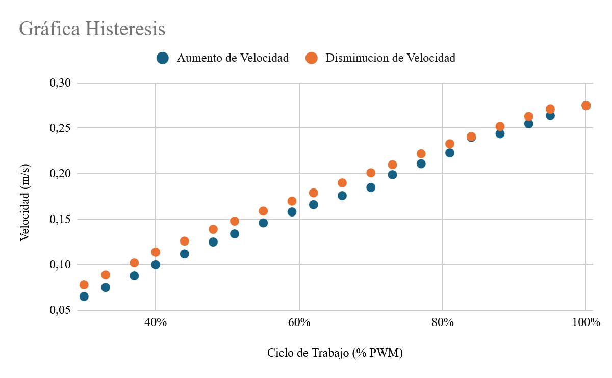

# Robot mesero con ESP32 y Modbus TCP

Proyecto final de Ingeniería Mecatrónica en la Universitaria Agustiniana (Bogotá, 2026).

Hicimos un carrito seguidor de línea que recorre un buffet y para en la mesa
que le indiquen. Se controla desde una HMI por Modbus TCP, como si fuera un
equipo más de una planta industrial: la HMI ve en vivo la velocidad, la carga
de la bandeja y la distancia al obstáculo más cercano, y puede cambiar la mesa
de destino, la velocidad y las constantes del PID sin reprogramar el robot.

**Video de las pruebas del PID y del conteo de mesas:**
[pruebas PID.mp4](https://drive.google.com/file/d/1Fri1YFBv56BYlUpE2OZAiU20e-KFlie6/view)

## Cómo funciona

El robot sigue una línea negra con una regleta de 8 sensores infrarrojos y un
PID. En el piso hay placas metálicas, una por mesa; un sensor inductivo las
cuenta y, cuando el conteo llega a la mesa que pidió la HMI, el robot frena.
También frena si la bandeja llega a 250 g o si detecta algo entre 7 y 11 cm al
frente.

El reto principal fue de tiempos. Leer la balanza HX711 y el sensor láser por
I2C bloquea el programa unos milisegundos, y si eso ocurre dentro del ciclo del
PID, el control de la línea pierde estabilidad. Lo resolvimos repartiendo el
trabajo entre los dos núcleos del ESP32 con FreeRTOS:

- **Núcleo 1** corre el lazo de control cada 10 ms: lee la línea, calcula la
  velocidad con los encoders, aplica el PID y manda el PWM a los motores.
- **Núcleo 0** atiende Modbus y los sensores lentos cada 100 ms.
- Las dos variables que comparten (peso y distancia) están protegidas con un
  mutex, para que un núcleo no lea a medias lo que el otro está escribiendo.

## Registros Modbus

El ESP32 es el servidor Modbus TCP (puerto 502, IP fija) y la HMI es el cliente.

| Dirección | Tipo | Variable | Qué es |
|---|---|---|---|
| 30001 | Input | `porcentaje` | Nivel de batería, 0 a 100 % |
| 30002 | Input | `velocidadPromedio` | Velocidad en cm/s × 100 |
| 30003 | Input | `contador` | Marca (mesa) en la que va, 0 a 11 |
| 30004 | Input | `tofCopia` | Distancia al frente en mm |
| 30005 | Input | `posicionLinea` | Posición sobre la línea, 0 a 7000 |
| 30006 | Input | `pesoCopia` | Peso en la bandeja en gramos |
| 40001 | Holding | `valorParadaModbus` | Mesa donde debe parar |
| 40002 | Holding | `kp_lin` | Kp × 1000 |
| 40003 | Holding | `ki_lin` | Ki × 1000 |
| 40004 | Holding | `kd_lin` | Kd × 1000 |
| 40005 | Holding | `basePwm` | Velocidad base, 0 a 255 (0 lo detiene) |

## La HMI

Tiene dos pantallas. La de operación, arriba, es para el personal del
restaurante: mesa objetivo, batería, carga, velocidad y el mapa del buffet con
las 10 mesas. La de ingeniería queda protegida y sirve para ajustar el PID y la
velocidad en caliente mientras el robot está en la pista.

## Instrumentación

Documentamos el robot con el plano de instrumentación ISA 5.1 y calibramos la
velocidad del encoder contra un cronómetro, subiendo y bajando el PWM del 30 al
100 %. La diferencia entre subir y bajar (histéresis) no pasó de 0,016 m/s.

Las tablas de calibración, la ficha técnica del prototipo y la lista de tags
están en [docs/instrumentacion.md](docs/instrumentacion.md).

## Hardware

| Parte | Referencia |
|---|---|
| Controlador | ESP32 (ESP-WROOM-32) |
| Seguidor de línea | Regleta Pololu QTR-8 |
| Detección de mesas | Sensor inductivo LJ12A3-4-Z/BX |
| Encoders | HC-020K, disco de 20 ranuras |
| Peso | Celda de carga de 5 kg con HX711 |
| Distancia | Sensor ToF VL6180X |
| Motores | 2 motores TT 1:90 con driver L298N |
| Indicador | Anillo NeoPixel WS2812B |
| Batería | LiPo 3S de 11,1 V |

## Compilar el firmware

El código está en [`firmware/robot_mesero/robot_mesero.ino`](firmware/robot_mesero/robot_mesero.ino).
Se abre con el IDE de Arduino y el paquete de placas ESP32, y usa estas
librerías: `modbus-esp8266` (ModbusIP), `VL6180X` de Pololu, `QTRSensors`,
`HX711` y `Adafruit NeoPixel`.

Antes de cargarlo hay que poner el nombre y la clave de la red Wi-Fi, y la IP
fija que va a usar el robot.

## Equipo

- Daniel Cartagena
- Andrés Felipe Segura Tinjacá
- Brayan Esteban Santamaría
- José David Vargas Vargas
