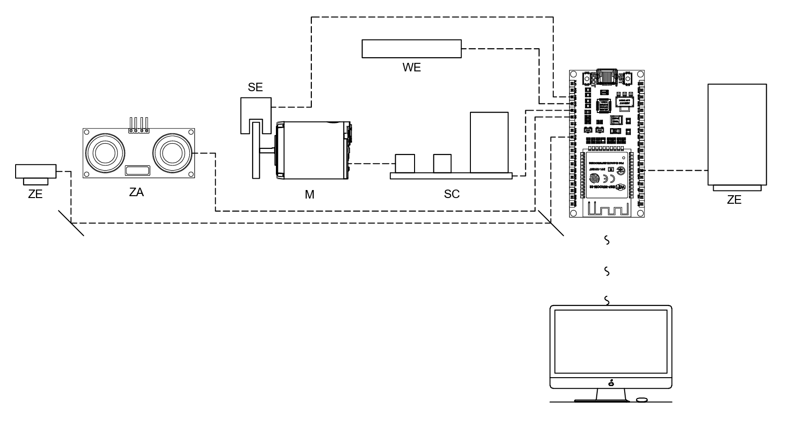
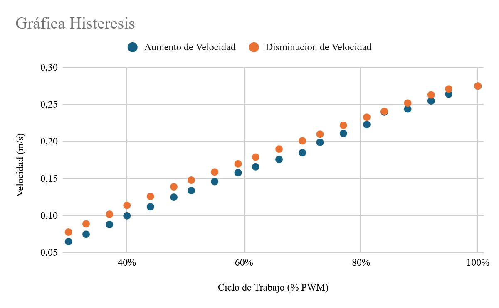

# Instrumentación del prototipo

## Ficha técnica

| | |
|---|---|
| Aplicación | Transporte de loza en un buffet, a escala de laboratorio |
| Controlador | ESP32 (ESP-WROOM-32), doble núcleo a 240 MHz |
| Alimentación | LiPo 3S de 11,1 V; lógica a 5 V y 3,3 V, motores a 8 V |
| Consumo | 100 mA en reposo, 550 mA en crucero (60 % PWM), 1,2 A en pico |
| Dimensiones | 27,6 × 15,0 × 13,8 cm (alto × ancho × fondo) |
| Peso | 749 g vacío (649 g chasis y electrónica, 100 g bandeja en PLA) |
| Protección | IP00, electrónica expuesta |

## Lista de instrumentos (ISA 5.1)

| Tag | Elemento | Ubicación |
|---|---|---|
| ZE-101A / B / C | Sensores infrarrojos de línea (izquierdo, central, derecho) | Parte inferior |
| ZE-101 | Sensor inductivo que detecta las placas de cada mesa | Parte inferior |
| ZA-101 | Alarma de obstáculo | Parte frontal |
| WE-101 | Celda de carga | Plataforma |
| WIT-101 | Transmisor de peso hacia el controlador | Integrado al controlador |
| WAH-101 | Alarma de peso alto | Integrado al controlador |
| WSL-101 | Interruptor de peso bajo (robot vacío) | Integrado al controlador |
| SE-101A / B | Encoders de las ruedas derecha e izquierda | Motores |
| SC-101 | Driver puente H | Chasis |

## Calibración del encoder

### 20 muestras al 60 % de PWM

| | |
|---|---|
| Velocidad promedio (encoder) | 0,1626 m/s |
| Desviación estándar | 0,0092 m/s |
| Error estándar | 0,0021 m/s |
| Referencia con cronómetro | 0,14 m/s |
| Exactitud | 83,9 % |
| Precisión | 94,4 % |

La referencia se tomó cronometrando el recorrido de una distancia conocida, así
que arrastra el error humano de iniciar y parar el cronómetro.

### Subiendo y bajando el PWM

| PWM | Encoder subiendo (m/s) | Encoder bajando (m/s) | Cronómetro subiendo (m/s) | Histéresis (m/s) |
|---|---|---|---|---|
| 30 % | 0,065 | 0,078 | 0,047 | 0,013 |
| 40 % | 0,100 | 0,114 | 0,082 | 0,014 |
| 51 % | 0,134 | 0,148 | 0,116 | 0,014 |
| 62 % | 0,166 | 0,179 | 0,148 | 0,013 |
| 70 % | 0,185 | 0,201 | 0,172 | 0,016 |
| 81 % | 0,223 | 0,233 | 0,210 | 0,010 |
| 92 % | 0,255 | 0,263 | 0,240 | 0,008 |
| 100 % | 0,275 | 0,275 | 0,256 | 0,000 |

(Selección de las 20 muestras de cada barrido.)

